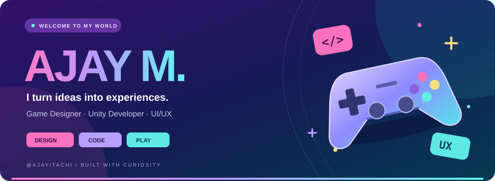

<b>Crafting playful experiences, one idea at a time.</b>

## ✨ A little about me

Hey, I'm **Ajay M** a **game designer, Unity developer, and UI/UX enthusiast**. I bring gameplay, visual design, and code together to turn ideas into interactive experiences.

<table>
<tr>
<td width="33%" align="center"><h3>🎮 Design for play</h3>
Gameplay mechanics Level design Player experience
</td>
<td width="33%" align="center"><h3>⚡ Build &amp; explore</h3>
Unity prototypes Browser games AR / VR experiments
</td>
<td width="33%" align="center"><h3>🎨 Make it feel right</h3>
UI/UX design Visual composition Intuitive interfaces
</td>
</tr>
</table>

## 🚀 The project arcade

A selection of my game experiments and design projects. Pick a project and take a look inside.

<table>
<tr>
<td width="50%" valign="top"><h3>🧟 Zombie Shooting</h3>
A 3D game project exploring zombie combat.
<a href="https://github.com/Ajayitachi/ZombieShooting"><b>Explore project →</b></a>  </td>
<td width="50%" valign="top"><h3>🎮 Zombie Survival</h3>
HTML and JavaScript gameplay with visual and audio assets.
<a href="https://github.com/Ajayitachi/Zombie-Survival"><b>Explore project →</b></a>  </td>
</tr>
<tr>
<td width="50%" valign="top"><h3>🕹️ 2D Game</h3>
A 2D game project from my development journey.
<a href="https://github.com/Ajayitachi/2D-Game-"><b>Explore project →</b></a>  </td>
<td width="50%" valign="top"><h3>🥽 AR / VR</h3>
Experiments with augmented and virtual reality.
<a href="https://github.com/Ajayitachi/Virtual-Reality-And-Augmented-Reality"><b>Explore project →</b></a>  </td>
</tr>
<tr>
<td width="50%" valign="top"><h3>🎧 Music Player UI</h3>
Exploring music interfaces and visual composition.
<a href="https://github.com/Ajayitachi/musicplayerui"><b>Explore project →</b></a>  </td>
<td width="50%" valign="top"><h3>🎬 Netflix Landing Page</h3>
A landing page focused on interface design and layout.
<a href="https://github.com/Ajayitachi/Netflix-Landing-Page"><b>Explore project →</b></a>  </td>
</tr>
</table>

## 🧰 Tools behind the ideas

<b>Prototype → Playtest → Refine → Repeat</b> Always learning through building.

---

<h2 align="center">🌈 Great experiences start with a conversation.</h2>

Into games, interactive worlds, or thoughtful design? Explore my work and connect with me.

<a href="https://ajayitachi.github.io/"><b>Visit my portfolio ↗</b></a> &nbsp; ✦ &nbsp; <a href="https://www.linkedin.com/in/ajay-m-itachi07"><b>Find me on LinkedIn ↗</b></a>

🟣 &nbsp; 🔵 &nbsp; 🩵 &nbsp; 🟡 &nbsp; 🩷 Design with intention. Build with curiosity. Keep creating.

